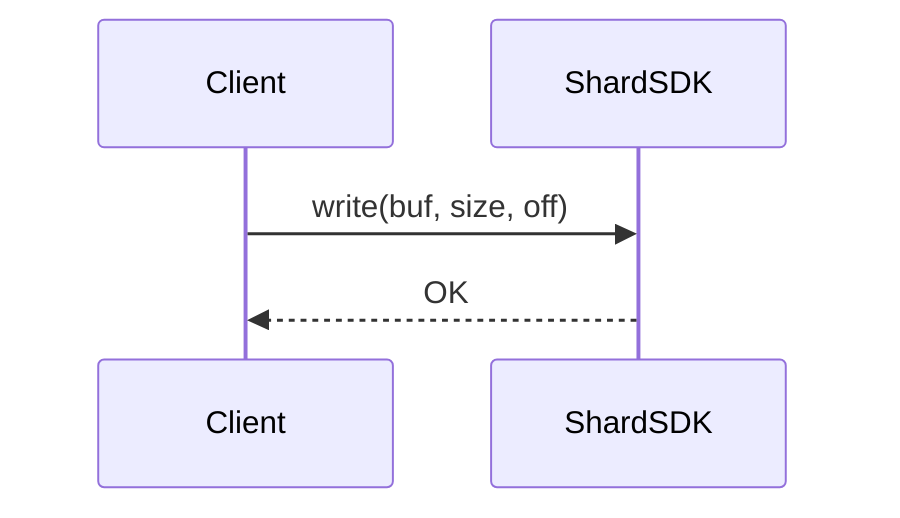

# 设计分析 → 软设澄清文档（Design Analysis → SWDD）

将 `$design-analysis` 产出的设计文档转换为团队软设澄清所需的正式文档，遵循飞书标准模板格式。

## AI 读法约定

> **规则标签**：`[必做]` 硬约束 / `[推荐]` 默认做；不适用时文档说明跳过 / 无标签为参考。
>
> **产出文档倾向**：表格 > 列表 > 段落；结论 > 阐述；**引用 analysis 章节 > 复述内容**（analysis 对评审可见，SWDD 只写结论 + 章节链接）。
>
> **长度预算**（参考）：SWDD 典型 400~600 行（评审用，不是资料库）；超过时先过 P5 排除项清扫，重点查是否从 analysis 整段搬了推演过程、是否有重复章节（公共结论未合并到统一章节）。

**输入**：`docs/design/<module>/<feature>_analysis.md`（design-analysis 的产出）——**analysis 是 SWDD 的唯一权威输入**。范围声明 / 承诺级别 / 架构 / Proto / 规格数字 / 决策结论都从 analysis 读取。

> **前置检查**：analysis 必须已完成 design-analysis 最后的**设计自检**（范围声明稳定、"后续大交付"不混进正文、⚠️ 待决策项清零）。未通过自检的 analysis 不允许派生 SWDD——立即停下来提示用户"先收敛 analysis 再来派生"，不要带着膨胀的 analysis 硬写。
>
> **SWDD 和 spec 并行独立**：两者是 analysis 的独立下游契约（评审契约 vs 编码契约），语义并行、互不依赖。spec 在本流程里**不是输入**；如评审时确需参考 spec 的某个细节（如完整 Proto 代码），由用户显式提供，不要自动去读 spec。

**输出**：默认遵循仓库既有 SWDD 位置（先 `ls docs/design/<module>/ docs/swdd/ 2>/dev/null`）；缺省 `docs/design/<module>/<feature>_swdd.md`（本地），可选推送到飞书。

## 核心原则

1. `[必做]` **读者是团队评审者 + SWDD 回答"怎么做、有什么影响"**（不是 AI 编码；不是"做什么/为什么"——那是 analysis）
2. `[必做]` **引用优先，结论粒度**——analysis 对评审可见，凡 analysis 已展开的（架构推演 / 完整时序图 / struct layout / 规格推演 / 竞品细节）SWDD 不复述，只写结论（承诺级别 / 影响面 / 关键数字 / 风险点）+ 章节链接
3. `[必做]` **检查项表格是灵魂**——每问题的检查项必须覆盖异常路径（不存在 / 超限 / 冲突 / 权限不足），不只正向
4. `[必做]` **补齐 analysis 未覆盖的维度**——兼容性 / 升级 / 可观测性（metrics/告警/运维/INJECT/日志）/ 测试
5. `[推荐]` **组织方式可选**——默认按问题组织；用户明确给出结构时直接服从
6. `[推荐]` **区分评审信息与实现细节 + 项目相对路径**——内部实现名词不进 SWDD 正文；文件引用用项目相对路径

## 流程总览

五个 Phase：**P1 准备**（读 analysis → 锁范围 → 选结构）→ **P2 逐单元设计方案**（11 点清单）→ **P3 核心流程**（时序图）→ **P4 产物章节**（接口 / 错误码 / 可观测性 / UT）→ **P5 组装与清扫**。全程维护承诺状态：current scope / follow-up / out-of-scope / requires product decision。

---

## Phase 1：准备（读 analysis → 锁范围 → 选结构）

### 1.1 前置检查（强制）

1. `[必做]` **核对 analysis 设计自检证据**：范围声明稳定、当前交付的重大决策已明确；缺少“自检”标题时先按设计自检补查，不能仅因标题缺失阻塞
2. `[必做]` **按上下文核对 `⚠️` / "待决策"**：排除示例、历史和 follow-up；仅影响本次承诺的未决项请求确认
3. **阻塞只沿真实依赖传播**：受未决重大选择影响的内容保留 requires product decision，其余章节继续完成；不得把草稿或未决项宣称为可验收承诺

### 1.2 读 analysis

按"范围声明 / 核心设计章 / 规格估算 / 决策"四块顺序读，提取下表：

| 类别 | 来源（analysis 章节） | 提取内容 |
|------|---------------------|---------|
| 范围边界 | "范围声明"章 | 本次做什么 / 本次明确不做什么 / 后续大交付 |
| 需求背景 | "需求与产品决策"章 | 首期范围、能力矩阵、消费方列表 |
| 架构方案 | "架构全景"章 + 核心设计章 | 全景图、组件职责、数据流向 |
| 设计决策 | 核心设计章 + "决策"章 | 每个决策的结论和理由（不要对比过程） |
| 数据结构 | 核心设计章（数据结构） | Proto 定义、struct 概要 |
| 关键流程 | 核心设计章（时序图） | 时序图、配置/执行/交互/查询流程 |
| 生命周期 | "状态机 / 生命周期"章（若有） | 启动/退出/故障/传播延迟 |
| 功能配合 | "与现有体系的关系"章 + "应用层细节"章 + 跨组件状态同步章（若有） | 数据源、统计、可观测性、辅助能力角色 |
| 性能预算 | "规格估算"章 | per-op 延迟、内存增量、RPC 数字 |
| 决策跟踪 | "决策"章 + 后续规划附录 | 已解决 / 已知限制 / 首期裁剪 |

> **引用规则**：按章节**类型**引用，不写死 §X 编号（analysis 的骨架允许各方案自行编排章节顺序）。

### 1.3 范围锁定

> **analysis 的"范围声明"章是权威**（自检已把关）。

1. **提取大交付范围**：确认本次一把交付包含哪些功能。**SWDD 只感知"大交付"层次**——产品/版本级别的交付单元
2. **判断"单功能评审" vs "多功能打包评审"**：
   - **多功能打包评审**（CRUD + 直查 + grace + df/statfs 一起发布）：**SWDD 内部不再细分子阶段**——流程标题、接口清单、规格总结、UT 用例都按**功能单元**组织；不出现"阶段 N 开始……"
   - **单功能评审**（本轮只交付一个功能）：直接按那个功能组织即可
3. **继承已确认范围声明**：本文覆盖 / 不包含 / 承诺 / 不承诺；仅新出现的实质变化才向用户确认
4. `[必做]` **建立排除词表**：从"本文不包含"中提取 API / 内部术语 / 数据结构名，供 P5 排除项清扫使用
5. `[推荐]` **收集术语表**：本次新增或易混淆的概念、缩写；团队已有共识的不列
6. `[必做]` **构建承诺状态表**（评审摘要必备）：

   | Capability | Status | Acceptance in this MR | Evidence / owner doc | Notes |
   |---|---|---|---|---|
   | ... | ✅ current scope implemented / ⚠️ follow-up, not this MR acceptance / ❌ out-of-scope / ❓ requires product decision | yes/no | analysis/spec section | ... |

   硬规则：状态为 follow-up 或 out-of-scope 的能力，不能出现在当前验收、测试通过条件或“已确定实现”描述中。

7. `[必做]` **构建角色分层表**（评审摘要必备）：

   | 角色 | 典型举例 | 约束级别 |
   |------|---------|---------|
   | **根本依赖** | 系统成立必须依赖的组件/数据源 | 强约束，必须交付 |
   | **辅助能力** | 帮助判断/观察（如 du、诊断 CLI） | 管理面工具，非系统依赖 |
   | **管理面工具** | 运维操作用（SetX、ListX） | 管控面，非 IO 路径 |

   目的：避免"帮助判断"被误读成"必须参与"。

### 1.4 选文档结构

默认**按问题组织**；也支持按决策点 / 按评审关注点。步骤：

1. 建议组织方式（按设计内容和评审场景）
2. 提取结构单元：按问题 → 核心问题列表；按决策点 → 关键技术选型；按评审关注点 → 评审议程
3. 按设计依赖拆分单元并说明映射；常规章节组织无需确认，用户明确要求先审批结构时保留该关卡
4. 建立结构 → 设计映射

**拆分原则**：一个单元 = 一个独立可评审的设计单元；跨多模块但逻辑一体的归同一单元；公共数据结构/Proto 提取为公共章节。

### 1.5 修订场景（若为修订版）

> 如果在已有 SWDD 基础上修订，且阶段定义或评审视角相比上一版**明显变化**（阶段范围缩减/扩大、组织方式切换），优先整篇重组，不在旧文上局部修补。

修订版必填**本轮变化表**（评审摘要之后）：

```markdown
## 本轮变化

| # | 变化项 | 上一版 | 本版 | 影响章节 |
|---|--------|--------|------|---------|
| 1 | 阶段划分 | 阶段 1~4 合并 | 阶段 1~3 合并，阶段 4 独立 | 范围声明、接口定义 |
```

来源：对比上一版 SWDD 与 analysis 最新范围声明，或从 git log 最近 commits 提取。

> **changelog / 本轮变化措辞规则**：行内**只描述本版加了什么 / 改了什么**，不写"没做什么 / 不引入 X / 避免了 Y"。反向描述会把禁用术语原文印进文档，下游评审者反而被误导成"作者考虑过 X 但放弃了"。被指出错误后，**修订是把 reverse 描述删掉，不是把整行删掉**——changelog 行本身仍然要保留。

---

## Phase 2：逐单元生成设计方案

> 对每个结构单元覆盖下面的 11 点清单。这是软设的核心。

### 2.1 公共结论提炼（强制）

多个单元共享的结论**必须**提炼到"设计方案"章节末尾的统一小节：

| 11 点清单项 | 默认归属 |
|------------|---------|
| 1 功能实现、2 容量规格、3 性能规格、4 容错、5 模块依赖、7 功能交互、10 资源消耗 | **按问题** |
| 6 内核态/用户态、11 第三方依赖 | **合并到 `### 运行形态与依赖`** |
| 8 兼容性、9 升级支持 | **合并到 `### 兼容性与升级支持`** |

> **例外**：某问题对上述合并项确有差异化（如新增第三方库），在该问题节单独条目 + 在统一章节引用。默认按矩阵合并。

### 2.2 11 点检查清单

逐项填写；不适用写"不涉及 + 原因"，不能留空。

> **"依据"列不是搬运源**——下表指明从 analysis 的哪些章节**读信息**，SWDD 里写**评审结论**（承诺级别 / 影响面 / 关键数字 / 风险点）。不要粘贴 analysis 原文。
>
> **第 8、9、11 项 SWDD 独占**（analysis 未覆盖），需新设计或补充。

| # | 检查项 | 依据 | 要写什么（结论粒度） |
|---|--------|-----|-------------------|
| 1 | **如何实现功能** | analysis 架构全景 + 核心设计章 | 承诺级别（强约束 / 体验层）+ 影响面 + 2-5 句实现要点；详细架构引用 analysis |
| 2 | **容量规格** | analysis 规格估算章 | 容量边界**数字** + 极端场景结论 + 评审关注点 |
| 3 | **性能规格** | analysis 规格估算章 + IO 路径分析 | per-op 延迟**数字** + 超标点 + 性能承诺 |
| 4 | **容错** | analysis 状态机/生命周期章 + 异常路径时序图 | 错误码 + 恢复策略；异常时序图若属"核心关键"则配图，否则引用 |
| 5 | **模块依赖** | analysis 需求与产品决策章 + 与现有体系关系章 | 依赖方向 + 版本 + 对上下游影响 |
| 6 | **内核态/用户态** | 代码分析 | 一句话结论 |
| 7 | **功能交互** | analysis 与现有体系关系章 + 应用层细节章 | 冲突点 + 配合要点 + 对评审影响 |
| 8 | **兼容性** | SWDD 独占 | Proto field number 变化 + RPC message 兼容 + 配置项兼容 + 灰度期行为差异 |
| 9 | **升级支持** | SWDD 独占 | 滚动升级顺序 + 数据迁移（是否需要、脚本位置）+ 配置迁移 + 回退路径 |
| 10 | **系统资源消耗** | analysis 规格估算章 | per-shard + 集群级**汇总数字** + 对规格影响结论 |
| 11 | **第三方依赖** | SWDD 独占，检查 `CMakeLists` / `conanfile.py` | 新增库/组件 + 版本 + 许可；如无"不涉及"一句话 |

### 2.3 检查项表格（每单元末尾）

```markdown
| 检查项 | API 错误返回信息 |
|--------|----------------|
| 检查 XXX 是否存在 | 指定 XXX {id} 不存在 |
| 检查 XXX 是否超过限制 | XXX 超过上限 {limit} |
```

提取方式：analysis 的边界场景和容错章节 + 项目错误码定义 + 现有类似功能的检查模式。**必须覆盖异常路径**（核心原则 #3）。

---

## Phase 3：核心流程

### 3.1 筛选原则（核心关键 / 交互影响大）

符合任一条进 SWDD：

- **核心链路**：主要 IO 路径 / 主要对外 API 的请求处理
- **跨模块 / 跨系统交互**：评审里最容易被追问
- **兼容性相关**：升级 / 灰度 / 数据格式迁移
- **关键故障恢复**：典型失败路径 + 恢复策略
- **状态传播**：配置生效、grace 过期、权限变更等对外可感知的状态变化

不满足 → 不进 SWDD，只在本章开头"引用索引"一行带过 + 链接到 analysis 对应章节。

> **不按数量卡**：关键流程多就都放，不关键的都引用 analysis。

### 3.2 格式

```markdown
## 核心流程

### 流程 1：XXX（如：写入请求处理）
说明该流程的触发条件和关键路径。



---

## Phase 4：产物章节（接口 / 错误码 / 可观测性 / UT）

> 这四节是"设计方案"之外的伴生章节，并列组织，每节自带最小模板和硬约束。

### 4.1 接口定义

> 只列当前大交付范围内的 API；未来 API 在范围声明的"本文不包含"中带过。部分实现的接口标"Phase N 完整实现"。

**数据结构粒度**：
- **对外 Proto / API 字段**：进 SWDD（评审要看外部契约：field number、类型、语义、错误码）
- **struct layout / 内部私有字段**：**不进 SWDD**，引用 analysis 数据结构小节
- **内部 RPC message**：**只在跨模块 / 跨系统边界**的进 SWDD；单模块内部的引用 analysis
- 每接口必写**触发条件**和**错误码**

```markdown
### 对外提供 API 接口
#### 接口 1：XXX
- **请求**：`XxxRequest` message 定义
- **响应**：`XxxResponse` message 定义
- **触发条件**：什么情况下调用
- **错误码**：可能返回的错误及含义

### 内部提供 API 接口
#### 接口 1：XXX
- **调用方**：模块A  **提供方**：模块B
- **参数** / **返回**：...
```

### 4.2 错误码

> **承诺状态规范**（§4.2 / §4.3 / §4.4 共用）：每行必须标注 `✅ current scope implemented` / `⚠️ follow-up, not this MR acceptance` / `❌ out-of-scope` / `❓ requires product decision` 之一。未定稿或未来能力不能伪装成当前结论。

```markdown
| 错误码 | 值 | 含义 | 触发场景 | 状态 |
|--------|-----|------|---------|------|
| XERR_XXX | 新增/现有 | 描述 | 什么操作触发 | ✅ current scope implemented / ⚠️ follow-up / ❌ out-of-scope / ❓ requires product decision |
```

从 analysis 中提取错误场景，查项目错误码定义决定复用或新增。

### 4.3 可观测性

> design-analysis 通常不覆盖。**可观测性是 SWDD 评审独有的必做章节**——运维/SRE 关心的是"上线后怎么判断健康、怎么诊断、怎么模拟故障"，不能只给日志就完事。
>
> **承诺边界**（评审摘要明说）：
> - **基本**：metrics + 日志 + dump-info 内部运维接口 + INJECT 注入点
> - **进阶**：上述 + 告警触发条件（触发信号就位，不主动推送）
> - **完整**：上述 + 告警订阅 / 主动推送 / Dashboard（通常留后续）
>
> SWDD 默认承诺至少到"进阶"档；承诺级别在评审摘要写清。

**五小节结构**：Metrics + 告警触发条件 + 运维命令 + INJECT + 日志。五节缺一不可（不适用明写"不涉及 + 原因"）。

#### 4.3.1 Metrics

> 命名对齐既有风格，不自造体系（项目具体前缀见项目 arch-constraints）。

| 层 | 典型 metric | 建议 label | 用途 |
|----|------------|----------|------|
| IO 路径 / Client | `xxx_precheck_total{result}` counter、`xxx_cache_lookup_total{result}` counter、`xxx_rpc_latency` histogram | 路径 / 结果分类 | 判断核心路径健康 |
| 服务端内部 | `xxx_cache_size{reactor_id}` gauge、`xxx_fetch_total{source,result}` counter | reactor / source | 判断缓存收敛与跨节点通信 |
| 聚合 / 状态机 | `xxx_state_transition_total{transition}` counter、`xxx_count{shard_id}` gauge | 状态名 | 捕获状态切换频率、规模 |

输出表六列：`Metric 名 / 类型 / Label / 说明 / 关联 SWDD 用例（可选）/ 状态`。

**硬约束**：标为 current scope 的 metric 本次必交付；follow-up metric 不能作为本 MR 验收；复用项目既有前缀；延迟单位在 metric 名明示（`_us` / `_ms` / `_seconds`）。

#### 4.3.2 告警触发条件

> **本次承诺**：触发条件 + 日志 + metric 齐备，值班可通过 grep / 告警规则感知事件。**不承诺**：订阅式推送（告警订阅通常是独立 infra）。

表六列：`事件 / 触发条件 / 日志样本 / 关联 metric / 级别 / 值班动作`。

- **触发条件**用 metric 表达式（Prometheus 风格），**不**用"可能有问题"等含糊描述
- **关联 metric** 必须是 §4.3.1 表里出现过的；否则表示你漏了 metric
- **告警级别**三档：CRITICAL / WARN / INFO

#### 4.3.3 内部运维命令

> 优先复用项目既有运维 CLI 框架（具体命令 / 注册模式见项目 arch-constraints）。不要新造专用 debug CLI。

三块清单：
1. 扩展既有 dump-info（三列：模块 / tag / 输出内容）
2. 管理面 CLI 的可观测性角色（在 §4.1 已定义，这里重述观测用途）
3. Metric 页面：Prometheus endpoint 路径一句话

**禁止**：列一堆"建议加的命令"却不承诺——每项必须标状态（✅ / ⚠️）。

#### 4.3.4 异常注入点（INJECT）

> **强制与 §4.4 UT 的 FS-N 用例一一对应**——FS 用例列了什么故障，这里就必须有对应注入点，否则 FS 用例无法执行。

表六列：`注入点 / 位置（provider, event）/ hook 数据 / 对应 FS 用例 / 用途 / 状态`。

- **位置**按项目既有注入框架格式（具体框架 / 示例见项目 arch-constraints）
- 末尾给 1-2 条**注入命令示例**（具体命令语法见项目 arch-constraints）
- **硬约束**：不承诺实现的注入点，对应 FS 用例也要标 ⚠️ 或移除

#### 4.3.5 日志

表五列：`操作 / 级别 / 日志样本 / 说明 / 状态`。

- **INFO**：正常业务操作完成、状态切换
- **WARN**：可恢复异常（超时重试、降级、接近限制、fallback 放行）
- **ERROR**：不可恢复错误（数据不一致、规格超限、IO 失败）→ 必须对接告警
- 必含**上下文 ID**（shard_id / ino / request_id / color 等）
- IO 热路径用 `LOG_EVERY_N` / `VLOG` 采样，避免刷屏
- 日志前缀统一（如 `[Quota]` / `[QuotaCli]`），便于 grep

#### 4.3.6 §4.3 自检（出 SWDD 前跑）

- [ ] §4.3.1~§4.3.5 五节齐备；承诺与评审摘要对齐
- [ ] Metrics 命名前缀已 grep 项目现有体系
- [ ] 告警触发的"关联 metric"都能在 §4.3.1 找到
- [ ] INJECT 与 §4.4 FS-N 一一对应，无孤儿
- [ ] 日志对接告警的 WARN/ERROR 都能在 §4.3.2 找到
- [ ] 运维命令给出既有框架的具体命令，而非"建议新增"

### 4.4 UT 和 Integration 用例设计

> **读者是测试（QA），不是开发**——用例描述白话、不含代码细节，测试可直接照着评审与排期。

**核心原则**：

1. `[必做]` **分类三节**：UT（白盒）/ Integration 功能（黑盒/灰盒）/ Integration 故障与稳定性（INJECT + 长稳）。故障/稳定性**单列**，不塞进 Integration——验收方式不同（"是否收敛" vs "是否正确"）
2. `[必做]` **禁用代码细节**：不写 `test_xxx.cc`、不提内部函数名、不列内部字段名；场景用业务语言
3. `[必做]` **类型三分**：白盒 / 灰盒 / 黑盒。UT 默认白盒；Integration 按是否依赖内部状态分灰/黑盒；黑盒最友好，多写
4. `[必做]` **优先级必标**：P0=上线阻塞；P1=应覆盖但非阻塞
5. `[必做]` **覆盖矩阵收尾**：末尾一张表，关联错误码/检查项 ↔ 用例编号
6. `[必做]` **归属必标**：每条用例加 `归属` 列，区分主要验收责任（如 `Server(<module>)` / `Client(<component>)` / `Infra(<shared>)` / `E2E(Server+Client)` / `External management` / `Shared(Proto/compat)`）。三节按**验收形态**分，`归属` 按**责任模块**分；不要用 Server/Client 分节替代 UT/OB/FS 三节。

**归属判定规则**：
- Server 端可独立验证的 handler / allocator / 持久化 / 错误码 → `Server(<module>)`
- Client / gateway / SDK / IO 路径行为 → `Client(<component>)`
- 共享基础设施（chain cache、proto compat、feature bit 等）→ `Infra(...)` 或 `Shared(...)`
- 必须跨 server + client + 管理面才能验收的行为 → `E2E(...)`
- 由外部管理面限制或观测、不作为后端验收的能力 → `External management`，不能写成 `Server follow-up`

**输出模板**（保留 4 小节）：

```markdown
## UT 和 Integration 用例设计

> 用例按可测边界分三类；`归属` 标主要验收责任，不替代三节分类。"类型·优先级·状态"列：P0/P1，✅/⚠️。

### UT（白盒）
| # | 归属 | 场景 | 前置条件 | 操作与预期 | 验收信号 | 类型·优先级·状态 |
|---|------|------|---------|-----------|---------|-----------------|
| UT-1 | Server(<module>) | ... | ... | ... | ... | 白盒 · P0 · ✅ |

### Integration 功能用例（黑盒 / 灰盒）
| # | 归属 | 场景 | 前置条件 | 操作与预期 | 验收信号 | 类型·优先级·状态 |
|---|------|------|---------|-----------|---------|-----------------|
| OB-1 | E2E(Server+Client) | ... | ... | ... | ... | 黑盒 · P0 · ✅ |

### Integration 故障与稳定性用例（INJECT + 长稳）
| # | 归属 | 场景 | 前置条件 | 操作与预期 | 验收信号 | 类型·优先级·状态 |
|---|------|------|---------|-----------|---------|-----------------|
| FS-1 | Client(<component>) | ... | ... | ... | ... | 灰盒 · P0 · ✅ |

### 覆盖矩阵
| 被覆盖对象 | 覆盖用例 |
|-----------|---------|
| `XERR_XXX` | UT-N、OB-M |
| <SWDD 问题 N 检查项> | OB-K |
| <INJECT 注入点对应> | FS-1、FS-2 |
```

**豁免**：当前阶段错误码 + 检查项合计 ≤ 3 项时可省略矩阵（手数过少反而形式主义）；省略时下方一句话说明。

**反模式**：
- 用 `test_xxx.cc` / 内部函数名作为用例名 → 用业务场景
- 只写 UT + Integration 两节，故障塞在 Integration → 三节
- 类型列写"UT / Integration"（层级）→ 按白/灰/黑盒（怎么测）
- 所有用例都 P0 → P0/P1 分
- 没有覆盖矩阵 → 末尾必须有
- "关键断言"写"功能正确" → 写测试直接可复用的验收信号
- 集成测试术语必须全文一致，不混用项目内部历史名称
- 用例只按 Server/Client 分节导致验收形态丢失 → 保留 UT/OB/FS 三节，新增 `归属` 列
- 外部管理面限制写成 Server follow-up → 标 `External management`，且不作为后端当前验收

---

## Phase 5：组装与清扫

### 5.1 输出文档结构（严格按模板）

```markdown
# [功能名称] 软件详细设计

## 飞书项目链接
[FR 标题](飞书项目链接)

## 变更记录
| 版本 | 日期 | 作者 | 变更说明 |
|------|------|------|---------|
| v0.1 | YYYY-MM-DD | <git user 英文名> | 初版 |

> 首版必写 v0.1；作者用 git user 英文；每次修订追加一行，不覆盖。
> **与"本轮变化"区分**：变更记录 = 版本累积历史；本轮变化 = 当前版 vs 上一版 diff。

## 评审摘要

### 范围声明
- **本文覆盖**：...
- **本文不包含**：...
- **本阶段承诺**：...
- **本阶段不承诺**：...

### 角色分层
| 角色 | 组件/能力 | 约束级别 |
|------|----------|---------|
| 根本依赖 | ... | 强约束，必须交付 |
| 辅助能力 | ... | 管理面工具，非系统依赖 |
| 管理面工具 | ... | 管控面，非 IO 路径 |

### 架构设计重点 / 测试重点 / 产品确认项 / 规格与资源总结
（各一小节，按本次要点一句话列）

### 术语表
| 术语 | 全称/来源 | 说明 |

## 本轮变化（修订时必填）
| # | 变化项 | 上一版 | 本版 | 影响章节 |

## 设计方案

### 问题 1：[问题标题]
> analysis 对应章节：[章节名] / [章节名]

**功能实现** / **容量规格** / **性能规格** / **容错** / **模块依赖** / **功能交互** / **资源消耗**
| 检查项 | API 错误返回信息 |

### 问题 2：...

### 兼容性与升级支持（统一章节）
Proto / RPC / 存储格式兼容 / 灰度期行为差异 / 发布顺序 / 回退

### 运行形态与依赖（统一章节）
内核态/用户态 / 第三方依赖

## 核心流程
[mermaid 时序图]

## 接口定义
### 对外 API / 内部 API

## 错误码
[表]

## 可观测性
### Metrics / 告警触发条件 / 内部运维命令 / 异常注入点（INJECT）/ 日志

## UT 和 Integration 用例设计
### UT（白盒）/ Integration 功能 / Integration 故障与稳定性 / 覆盖矩阵
```

### 5.2 输出位置与飞书推送

1. **本地**：`docs/design/<module>/<feature>_swdd.md`
2. **飞书**（可选）：`lark-cli docs +create` 创建；流程遵循 `feishu-doc` skill——路由决策、发布前检查（链接/转义/格式/长度）、Rule 0 禁止原地更新、warning 处理、回读验收
3. SWDD 特有约定：标题格式 `XXX 软件详细设计`；新版 SWDD 整篇重发或 append 勘误章节（鼓励本地改到位再发）
4. **双源同步范围**：本地 SWDD 修订到飞书时，**核心内容 + 变更记录表 + 本轮变化表三者必须一起同步**——只要变更记录追加了 vN.M 一行，意味着这三处都改了，飞书侧也要全部跟上。漏改 metadata 表会让评审者从飞书目录看不到本轮在改什么

### 5.3 排除项清扫（出 SWDD 前跑一遍）

1. **排除词扫描**：用 P1.3 建立的排除词表 grep 全文，清除或降级为"本文不包含"引用
2. **链接规范**：绝对路径替换为项目相对路径
3. **术语降噪**：当前阶段不关键的实现细节名词（内部 ID 字段、未来 API 参数）如不影响评审则删除
4. **范围一致性**：所有接口 / 流程 / 测试用例都属于 P1.3 锁定的大交付范围（以 analysis 的"范围声明"章为准）
5. **承诺级别交叉检查**：评审摘要的"本阶段承诺/不承诺"与正文描述一致，无矛盾
6. **角色分层交叉检查**：评审摘要标为"辅助能力 / 管理面工具"的组件，正文不能写成"系统依赖""必须参与"
7. **已定/待定标注完整性**：错误码、日志、UT/Integration 用例表每行都标 ✅ / ⚠️
8. **修订版本变化表**：修订版"本轮变化"表必须填写，不能为空
9. **冗余公共结论扫描**：grep 问题节（H3 `### 问题 N`）内是否重复出现 `**兼容性**` / `**升级支持**` / `**内核态/用户态**` / `**第三方依赖**` —— 重复则合并到统一章节
10. **变更记录完整性**：`## 变更记录` 表存在且 ≥1 行；修订版每次追加一行
11. **多阶段打包交付时的阶段漂移**：若 P1.3 判定为多阶段打包交付，grep 正文是否残留"阶段 1""阶段 2、3""Phase N 开始"等阶段轴描述（正常残留点只有"本文不包含"引用）；发现则合并到统一功能单元描述
12. **用例章节完整性与白话化**：§4.4 三表 + 覆盖矩阵齐备；每张用例表都有 `归属` 列且每行非空；grep 正文无 `test_.*\.cc` / `integration_.*_e2e` / 函数名式用例名；章节标题统一为"UT 和 Integration"
13. **搬运检查**：抽查设计方案里的架构描述 / 核心流程 / 数据结构是否从 analysis 整段复制。信号："方案 A vs B 对比" / "推演过程" / "struct layout" 等 analysis 粒度 → 保留结论 + 引用，删除推演。每个问题节的"analysis 对应章节"链接齐全
14. **可观测性五节完整**：§4.3 下必须有 Metrics / 告警触发条件 / 内部运维命令 / 异常注入点 / 日志 五小节；缺节必须明写"不涉及 + 原因"
15. **INJECT ↔ FS 对应**：§4.3.4 INJECT 表与 §4.4 FS 表交叉检查——FS-N 用例全部能找到对应注入点；INJECT 表无孤儿项
16. **Metrics ↔ 告警关联完整性**：§4.3.2 的"关联 metric"列每行都能在 §4.3.1 找到对应条目
17. **承诺状态一致性**：所有接口、错误码、metrics、日志、INJECT、UT/OB/FS 用例都标注 current scope / follow-up / out-of-scope / requires product decision；follow-up 项不能出现在当前验收条件；`External management` 用例不能计入 Server/Client 覆盖率。
18. **Spec 对齐**：列为 current scope 的 metric/bvar/log/error code 必须能在 spec 的 Boundary/Error、Runtime Invariant 或 RCT 表中找到对应项；找不到就降级为 follow-up 或补 spec。
19. **项目基础设施概念校验**：grep "Raft / RocksDB / Paxos / leader / follower / replica / split / merge / snapshot 复制"等通用基础设施措辞，**每一项必须能在项目架构文档（`docs/design/**/*architecture*.md` / `*spec*.md`）或代码里找到对应实现**。analysis 里出现 ≠ 项目里存在（analysis 也可能错）；通用 SRE 知识也不能直接套用。不存在的概念不要用通用术语兜底（"由 Raft + RocksDB 保证"），改成"由本模块自身的 X 机制保证"或直接不展开实现细节。
20. **changelog 反向描述清扫**：grep `## 变更记录` / `## 本轮变化` 表内有无"不引入 / 不包含 / 避免 / 没有用 / 不使用"等反向措辞——changelog 只写正向（加了什么 / 改了什么），反向描述会把禁用术语印进文档，下游评审者反而被误导。删掉反向描述部分，但保留行本身。

### 5.4 发现问题时的处理

- 残留排除项：移除或改写为"计划在后续版本实现"一句话说明
- 绝对路径：替换为项目相对路径
- 非必要实现细节：删除或移入脚注
- 承诺矛盾：以 P1.3 范围声明和承诺状态表为准，修正正文；无法确认时标为 `❓ requires product decision`，不要写成已实现

---

## design-analysis → SWDD 映射速查

| SWDD 章节 | design-analysis 来源 | 是否需要补充 |
|-----------|---------------------|------------|
| 飞书项目链接 | 无 | 用户提供 |
| 变更记录 | 无 | 首版手填 v0.1；修订追加 |
| 评审摘要 | analysis 需求与产品决策章 + 规格估算章 + P1.3 范围声明 | 从各章节汇总 |
| 评审摘要.术语表 | 设计文档全文 | 提取新增概念 |
| 设计方案.问题 N 下 7 项（功能/容量/性能/容错/模块/交互/资源） | P2.2 11 点检查清单 | 按清单执行 |
| 设计方案.兼容性与升级支持（统一） | 需补充 | Proto/RPC 兼容 + 灰度期行为 + 发布顺序 + 回退 |
| 设计方案.运行形态与依赖（统一） | 代码分析 + CMakeLists | 内核态/用户态 + 第三方依赖 |
| 检查项表格 | analysis 核心设计章（决策）+ 边界场景 | 重组为校验格式 |
| 核心流程 | analysis 核心设计章（时序图） | 补充管控面 |
| 对外接口 | analysis 核心设计章（Proto 定义） | 格式化为 API 描述 |
| 内部接口 | analysis 核心设计章（数据结构 + 时序图） | 按范围过滤 |
| 错误码 | 项目错误码定义 + 设计 | 汇总表 |
| 可观测性.Metrics | 项目 arch-constraints + 设计 | 三类分表；前缀对齐 arch-constraints |
| 可观测性.告警触发条件 | 设计 + analysis 风险章节 | 触发条件用 metric 表达式；关联 §Metrics |
| 可观测性.内部运维命令 | 项目 arch-constraints | 扩展既有命令；每项标状态 |
| 可观测性.INJECT 注入点 | 项目 arch-constraints | 与 §4.4 FS-N 一一对应 |
| 可观测性.日志 | 无 | 全新设计；与告警对接 |
| UT/Integration（白/灰/黑盒 三分 + 归属列 + 覆盖矩阵） | 无 | 全新设计；业务场景命名；归属按主要验收责任标注 |

## 反模式

> 按元类别组织，只收录"评审视角特有"。项目特定反模式维护在项目 arch-constraints 的"典型盲区"章节。

### 1. 结论粒度违反（核心原则 #2 违反）
| 触发场景 | 正确做法 |
|---------|---------|
| 把 analysis 方案对比 / 推演过程 / 完整时序图 / struct layout 整段搬过来 / 11 点清单"依据"列被当搬运源 / 机械限定"保留 2-3 张时序图" | 只写终态结论 + 引用 analysis 章节；依据列只指明"读哪里"，写 SWDD 时产出评审结论；流程按"核心关键 + 交互影响大"筛选不按数量卡 |

### 2. 边界不清（范围 / 承诺 / 角色）
| 触发场景 | 正确做法 |
|---------|---------|
| 未来阶段 API 出现在接口章节 / 内部实现名词进 SWDD 正文 / 辅助工具写成"系统依赖" / 承诺不清 | 仅列当前阶段 API；区分"评审必要信息"和"实现细节"；评审摘要加角色分层表；承诺级别在评审摘要明说（基本 / 进阶 / 完整） |

### 3. 评审导向违反
| 触发场景 | 正确做法 |
|---------|---------|
| 检查项表格只写正向 / 兼容性只说"向后兼容" | 覆盖异常路径（不存在 / 超限 / 冲突 / 权限不足）；兼容性具体到 Proto field number / RPC message / 配置键 |

### 4. 可观测性不完整（核心原则 #4 违反）
| 触发场景 | 正确做法 |
|---------|---------|
| 只写"日志信息"一层，忽略 metric / 告警 / 运维命令 / INJECT | §4.3 五节齐备（Metrics + 告警 + 运维命令 + INJECT + 日志）；不适用则明写"不涉及 + 原因" |
| 建议加 metric 但不承诺 / 新建独立 debug CLI / 自造 metric 前缀 | 承诺项标 ✅、不承诺标 ⚠️ 或移除；命名与运维框架对齐项目 arch-constraints（不新造） |
| INJECT 列表与 FS 用例各自为政 | §4.3.4 INJECT 和 §4.4 FS-N 一一对应，孤儿项必须处理 |

### 5. 文档卫生
| 触发场景 | 正确做法 |
|---------|---------|
| 文件引用用本地绝对路径 / 在旧 SWDD 上反复局部修补 / 直接把 analysis 全部内容拿来 | 项目相对路径；阶段定义或评审视角明显变化时整篇重组；范围以 analysis 的"范围声明"章为准，未通过自检的 analysis 先收敛再派生 |
| 把 analysis 里的"Raft / RocksDB / leader 切换 / split-merge"等基础设施措辞直接搬进 SWDD，没核对项目代码 / 架构文档 | 用前 grep 项目架构文档（`*architecture*.md` / `*spec*.md`）确认该概念在本项目存在；不存在的不用通用术语兜底，改成"由本模块自身的 X 机制保证"或不展开（详见 §5.3 第 19 项） |
| changelog / 本轮变化表写"不引入 X / 不包含 Y / 避免 Z" | 只写正向（加了什么 / 改了什么）；反向描述会把禁用术语印进文档（详见 §5.3 第 20 项） |
